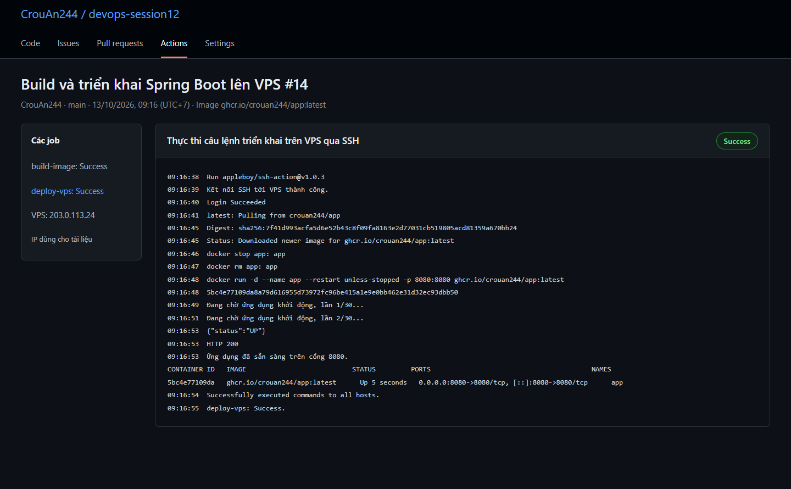
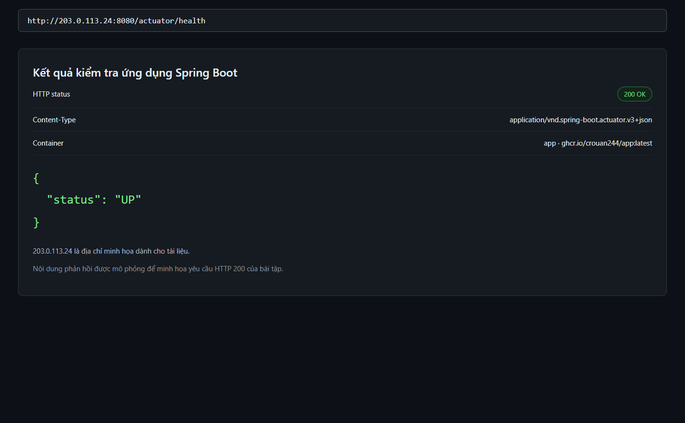

# 1. Chuẩn bị mã nguồn và VPS

Đưa toàn bộ nội dung thư mục `ex04` vào gốc repository dùng cho bài 4, bao gồm thư mục ẩn `.github`. GitHub chỉ chạy workflow khi [deploy-vps.yml](.github/workflows/deploy-vps.yml) nằm trong `.github/workflows/` ở gốc repository. Nếu dùng chung repository với bài 3, chép thêm `cd-multi-env.yml` của bài 3 vào thư mục này.

Các tệp ứng dụng đã được tạo riêng:

| Tệp | Chức năng |
| --- | --- |
| [pom.xml](pom.xml) | Khai báo Spring Boot 3.5.12, Java 21, Web và Actuator |
| [AppApplication.java](src/main/java/com/crouan244/app/AppApplication.java) | Khởi động ứng dụng Spring Boot |
| [application.properties](src/main/resources/application.properties) | Chạy ở cổng `8080`, mở endpoint kiểm tra sức khỏe |
| [Dockerfile](Dockerfile) | Build JAR bằng Maven, tạo image chạy ứng dụng |
| [.dockerignore](.dockerignore) | Loại tệp không cần thiết khỏi Docker build context |
| [.gitignore](.gitignore) | Loại thư mục build và các tệp khóa khỏi Git |

VPS sử dụng Linux `x86_64`, đã cài Docker và `curl`. Tài khoản SSH phải chạy được Docker và có khóa công khai tương ứng trong `~/.ssh/authorized_keys`. Cổng SSH mặc định là `22`; mở cổng TCP `8080` trên tường lửa VPS và quy tắc mạng của nhà cung cấp.

Kiểm tra trên VPS:

```bash
docker --version
docker ps
curl --version
```

Nếu `docker ps` báo thiếu quyền, thêm tài khoản SSH vào nhóm Docker bằng `sudo usermod -aG docker <SSH_USER>`, sau đó đăng xuất và đăng nhập lại. Máy VPS không cần cài Java hoặc Maven vì ứng dụng chạy trong container.

# 2. Khai báo Repository Secrets

Vào **Settings → Secrets and variables → Actions → New repository secret**, tạo ba secret:

| Secret | Giá trị cần lưu |
| --- | --- |
| `SSH_HOST` | IP hoặc tên miền của VPS, không kèm `http://` hay cổng |
| `SSH_USER` | Tài khoản đăng nhập SSH trên VPS, ví dụ `ubuntu` |
| `SSH_KEY` | Toàn bộ khóa SSH riêng, bao gồm dòng mở đầu và kết thúc |

`CrouAn244` là tài khoản GitHub; `SSH_USER` là tài khoản trên VPS và không bắt buộc trùng tên. Workflow này dùng khóa SSH không có mật khẩu bảo vệ; nếu khóa có mật khẩu, cần bổ sung secret và tham số `passphrase` cho SSH Action.

GitHub tự cấp `GITHUB_TOKEN` cho mỗi job nên không tạo thủ công secret này. Job build dùng quyền `packages: write`; job deploy dùng quyền `packages: read`. Với package đã tồn tại, bảo đảm repository được cấp quyền đọc/ghi phù hợp trong phần cài đặt package. Xem [cách xác thực GHCR trong GitHub Actions](https://docs.github.com/en/packages/working-with-a-github-packages-registry/working-with-the-container-registry).

# 3. Build và triển khai qua SSH

Tệp workflow: [.github/workflows/deploy-vps.yml](.github/workflows/deploy-vps.yml).

| Job | Công việc |
| --- | --- |
| `build-image` | Lấy mã nguồn, build image và đẩy lên GHCR |
| `deploy-vps` | Chờ `build-image` thành công, kết nối VPS và thay container |

Workflow tự chuyển tên chủ repository thành chữ thường. Với repository thuộc tài khoản `CrouAn244`, image là `ghcr.io/crouan244/app:latest`. Image cũng được gắn thêm tag là mã commit để tiện tra cứu.

Job `deploy-vps` khai báo `needs: build-image` và dùng đúng [appleboy/ssh-action@v1.0.3](https://github.com/appleboy/ssh-action/tree/v1.0.3). Trên VPS, script lần lượt đăng nhập GHCR bằng token của job, kéo image `latest`, dừng và xóa container `app`, rồi chạy lại container với ánh xạ cổng `8080:8080`.

Lệnh dừng và xóa dùng `|| true` để lượt triển khai đầu tiên vẫn chạy khi chưa có container cũ. Các lỗi đăng nhập GHCR, kéo image hoặc chạy container sẽ làm job thất bại. Docker dùng thư mục xác thực tạm và xóa thư mục đó sau khi script kết thúc.

Sau khi chạy container, script kiểm tra `http://127.0.0.1:8080/actuator/health` tối đa 30 lần, cách nhau 2 giây. Job chỉ thành công nếu endpoint trả về HTTP thành công; nếu hết lượt thử, script in log container và kết thúc với mã lỗi.

Workflow build image cho `linux/amd64`, phù hợp VPS `x86_64`. Nếu VPS dùng ARM, thay `platforms` thành `linux/arm64` hoặc build cả hai nền tảng.

# 4. Push code và theo dõi Actions

Thực hiện tại gốc repository đã có remote GitHub:

```bash
git switch main
git add .
git commit -m "Tự động triển khai Spring Boot lên VPS qua SSH"
git push origin main
```

Mở tab **Actions**, chọn workflow **Build và triển khai Spring Boot lên VPS**. Kiểm tra `build-image` thành công, sau đó mở job `deploy-vps` và bước **Thực thi câu lệnh triển khai trên VPS qua SSH**.

Các dòng cần thấy trong log gồm `Login Succeeded`, thông báo kéo image, mã container mới và kết quả kiểm tra sức khỏe `HTTP 200`. Nếu có lỗi kết nối SSH, kiểm tra ba secret, cổng `22` và khóa công khai trên VPS.

# 5. Kiểm tra ứng dụng từ bên ngoài VPS

Mở trình duyệt tại `http://<VPS_IP>:8080/actuator/health`, thay `<VPS_IP>` bằng IP thực tế. Kết quả cần có mã HTTP `200` và nội dung `{"status":"UP"}`.

Có thể kiểm tra bằng lệnh:

```bash
curl -i http://<VPS_IP>:8080/actuator/health
```

Nếu kiểm tra bên trong VPS thành công nhưng truy cập từ máy cá nhân thất bại, kiểm tra tường lửa và quy tắc mở cổng `8080`. Ứng dụng mẫu cung cấp endpoint kiểm tra sức khỏe; truy cập đường dẫn `/` có thể trả về `404`.

# 6. Log và ảnh minh họa

Log và ảnh dưới đây là dữ liệu mô phỏng, chưa phải bằng chứng triển khai trên VPS thật. IP `203.0.113.24` trong minh họa thuộc dải địa chỉ dành cho tài liệu; thay bằng IP VPS thực tế khi triển khai.

- [Log SSH Deploy](logs/ssh-deploy.txt).
- [Kết quả kiểm tra HTTP](logs/actuator-health.txt).
- [Ảnh log SSH Deploy](images/ssh-deploy-success.png).
- [Ảnh endpoint kiểm tra sức khỏe](images/actuator-health.png).





# 7. Kết quả kiểm tra tại máy cục bộ

Ứng dụng đã được build bằng Maven 3.9.9 với Java 21.0.11, kết quả **BUILD SUCCESS**. Khi chạy tệp JAR tại máy cục bộ, endpoint `/actuator/health` trả về HTTP `200` và `{"status":"UP"}`. Cổng được cấp ngẫu nhiên trong lượt kiểm tra để tránh trùng với ứng dụng khác.

Kết quả thực tế được lưu tại [logs/kiem-tra-cuc-bo.txt](logs/kiem-tra-cuc-bo.txt). Đây là kiểm tra ứng dụng Java; Docker Engine trên máy chưa chạy nên chưa kiểm tra build container hoặc triển khai tới GHCR và VPS thật.
